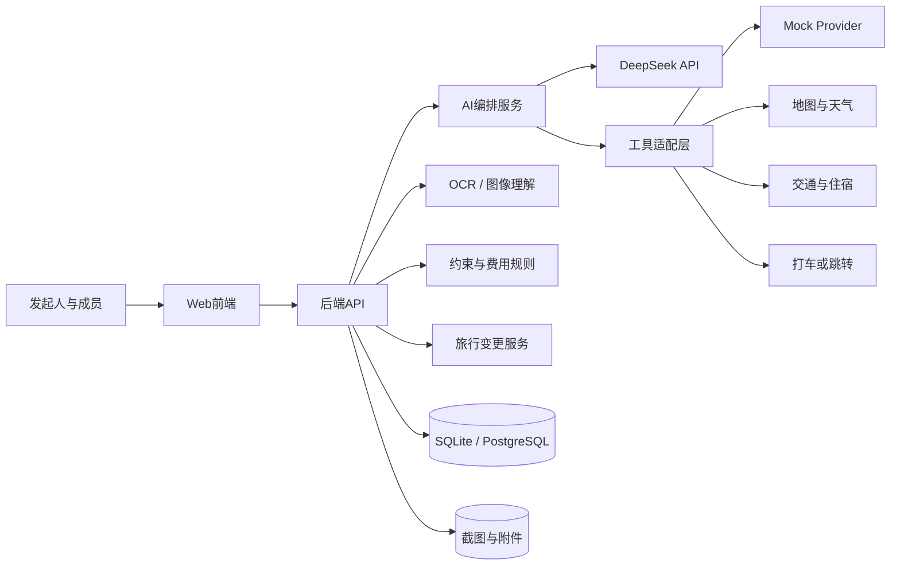

# 软件基础雏形实施说明

> 目标：先完成一个可运行、可演示、可验证的 Web 旅行助手，不在一开始接入所有真实外部服务。
>
> 范围：本文定义第一版软件结构、页面、接口、数据模型、AI流程、Mock服务、开发顺序和验收标准。

## 1. 雏形目标

第一版只围绕一个完整故事开发：

> 5 个朋友周末出游。小张预算较低，小李希望住得舒服；小王必须周日 20:00 前到家，小陈 21:00 后才能返程。出发后下雨，5 个人需要临时打车。

系统需要连续完成：

```text
创建旅行
  → 填写需求
  → 邀请成员
  → 导入群聊和截图
  → AI提取约束
  → 用户确认或纠正
  → 生成三个候选方案
  → 选择方案
  → 展示共同主干与个人分支
  → 分别计算团队费用与个人费用
  → 模拟旅途中变化
  → 用户确认后更新计划
```

## 2. 第一版不做的事情

- 不做真实支付；
- 不做自动购票；
- 不做真实网约车派单；
- 不直接读取个人微信；
- 不从12306抓取网页数据；
- 不训练大模型；
- 不做复杂账号、短信和实名认证；
- 不做大规模实时协同编辑；
- 不做完整订单履约系统。

真实能力通过明确标注的Mock数据、官方跳转链接或后续合作接口实现。

## 3. 推荐技术方案

为了尽快完成可运行雏形，默认使用：

| 部分 | 推荐方案 |
|---|---|
| 前端与后端 | Next.js + TypeScript |
| 页面样式 | Tailwind CSS + shadcn/ui |
| 数据库 | 开发环境使用 SQLite |
| ORM | Prisma |
| AI | DeepSeek API |
| 截图文字 | OCR 服务或多模态模型 |
| 地图 | 高德地图或百度地图，第一阶段可先Mock |
| 部署 | 可访问的云服务器或托管平台 |

如果团队对其他技术栈更熟悉，可以替换技术，但必须保留本文定义的数据契约和产品流程。

## 4. 总体架构



调用边界：

```text
AI负责理解、选择和解释
后端负责校验、计算和保存
外部服务负责提供事实和订单能力
用户负责最终确认
```

## 5. 仓库目录

```text
ruanjian/
  app/
    page.tsx
    trips/
      new/page.tsx
      [tripId]/
        page.tsx
        collaborate/page.tsx
        materials/page.tsx
        plans/page.tsx
        plan/page.tsx
        live/page.tsx
    api/
      trips/route.ts
      trips/[tripId]/route.ts
      trips/[tripId]/members/route.ts
      trips/[tripId]/materials/route.ts
      trips/[tripId]/extract/route.ts
      trips/[tripId]/plans/route.ts
      trips/[tripId]/confirm/route.ts
      trips/[tripId]/changes/route.ts
      rides/quote/route.ts
      rides/order-draft/route.ts
      rides/order-confirm/route.ts

  components/
    trip/
    plan/
    branch/
    cost/
    materials/
    common/

  lib/
    db.ts
    auth.ts
    ai.ts
    context-builder.ts
    schema-validator.ts
    cost-engine.ts
    share-token.ts
    mock-providers/
      transport.ts
      hotel.ts
      weather.ts
      ride.ts

  ai/
    prompts/
      system.md
      extract.md
      plan.md
      conflict.md
      live-change.md
    schemas/
      trip-brief.schema.ts
      group-signal.schema.ts
      trip-plan.schema.ts
      cost-item.schema.ts
    examples/
      chat-cases.jsonl
      conflict-cases.jsonl
      safety-cases.jsonl

  prisma/
    schema.prisma

  tests/
    unit/
    integration/
    e2e/

  public/
  .env.example
  README.md
  TASKS.md
  PROTOTYPE.md
```

## 6. 页面与路由

### 6.1 首页

路由：`/`

功能：

- 产品价值说明；
- “创建周末旅行”入口；
- “加入已有旅行”入口；
- 进入演示数据。

第一版不需要营销页面，首页能快速进入产品即可。

### 6.2 创建旅行

路由：`/trips/new`

表单字段：

- 旅行名称；
- 出发地；
- 目的地偏好；
- 日期和时间范围；
- 最晚返回时间；
- 人数；
- 总预算或个人预算；
- 兴趣偏好；
- 硬约束；
- 同行要求；
- 交通接受范围。

提交后：

1. 创建 `Trip`；
2. 创建发起人 `Member`；
3. 生成 `shareToken`；
4. 跳转到旅行主页；
5. 显示分享链接和二维码。

### 6.3 旅行主页

路由：`/trips/[tripId]`

展示：

- 旅行基本信息；
- 当前阶段；
- 成员加入状态；
- 材料导入状态；
- 已确认和未确认约束；
- 下一步按钮。

### 6.4 材料与需求提取

路由：`/trips/[tripId]/materials`

功能：

- 粘贴群聊文本；
- 上传截图；
- 上传收藏文字或链接；
- 查看处理进度；
- 查看AI提取结果；
- 查看原文证据；
- 修改错误理解。

页面必须区分：

- 已确认；
- 推测；
- 冲突；
- 未知。

### 6.5 多人补充与共识板

路由：`/trips/[tripId]/collaborate`

功能：

- 成员通过分享链接进入；
- 快速填写时间和预算；
- 表达偏好和硬约束；
- 查看共识；
- 查看尚存分歧；
- 评价候选方案；
- 确认自己的约束。

连接分享链接后，第一版只要求填写昵称，不要求完整注册。

### 6.6 方案对比

路由：`/trips/[tripId]/plans`

展示三个方案：

- 稳妥型；
- 体验型；
- 预算型。

每个方案包含：

- 目的地；
- 往返交通；
- 门到门时间；
- 总费用区间；
- 个人费用；
- 共同费用；
- 成员硬约束检查；
- 风险；
- 数据可信度；
- 未确认事项。

第一版所有价格明确显示：

> 演示估价，不是真实商品价格。

### 6.7 最终方案

路由：`/trips/[tripId]/plan`

页面布局：

```text
顶部概览
  ├── 目的地、日期、人数
  ├── 当前状态
  └── 总费用和待确认数量

中间时间轴
  ├── 共同行程
  └── 个人交通、返程和住宿分支

右侧控制区
  ├── 待确认事项
  ├── 风险和任务
  └── 费用与订单状态

底部
  ├── 费用明细
  ├── 版本记录
  └── 分享与导出
```

提供三个视图：

- 共享视图；
- 我的行程；
- 组织者控制台。

### 6.8 旅行中变更

路由：`/trips/[tripId]/live`

第一版演示事件：

- 原计划在户外活动；
- 忽然下雨；
- 5 人需要临时打车；
- 系统比较七座车、两辆车和公共交通；
- 用户选择后更新行程和费用。

页面流程：

```text
异常提示
  → 影响成员和行程段
  → 2—3个替代方案
  → 用户确认
  → 新版本行程
```

## 7. 数据库对象

第一版建议包含以下表：

| 对象 | 作用 |
|---|---|
| `Trip` | 旅行基本信息和当前阶段 |
| `Member` | 成员、预算、角色和邀请关系 |
| `Material` | 群聊文本、截图和收藏材料 |
| `Signal` | AI提取或用户确认的偏好与约束 |
| `Plan` | 候选方案和版本 |
| `Branch` | 不同交通、返程、房型或活动分支 |
| `CostItem` | 共同、分支和个人费用 |
| `Task` | 订票、预约、集合和装备任务 |
| `OrderDraft` | 订单草稿和用户确认状态 |
| `ChangeEvent` | 天气、延误和预约变化 |
| `AiRun` | 每次AI输入、输出、版本和校验结果 |

### 7.1 最小数据示例

```ts
type Trip = {
  id: string;
  title: string;
  origin: string;
  destinationPreference?: string;
  startAt: string;
  endAt: string;
  status: "draft" | "collecting" | "planning" | "confirmed" | "traveling";
  shareToken: string;
};

type Member = {
  id: string;
  tripId: string;
  name: string;
  role: "organizer" | "member";
  maxBudgetCents?: number;
};

type CostItem = {
  id: string;
  tripId: string;
  title: string;
  amountCents: number;
  scope: "shared" | "branch" | "personal";
  participantIds: string[];
  payerId?: string;
  status: "estimated" | "confirmed" | "paid";
  source: "live" | "cached" | "estimated" | "mock";
};
```

金额统一使用整数“分”保存。

## 8. API

### 8.1 创建与读取旅行

```text
POST /api/trips
GET  /api/trips/{tripId}
```

### 8.2 成员

```text
POST /api/trips/{tripId}/members
PATCH /api/trips/{tripId}/members/{memberId}
```

### 8.3 材料与信息提取

```text
POST /api/trips/{tripId}/materials
POST /api/trips/{tripId}/extract
PATCH /api/trips/{tripId}/signals/{signalId}
```

`extract` 必须返回：

- `signals`；
- `unknowns`；
- `conflicts`；
- `sources`；
- `aiRunId`。

### 8.4 方案与确认

```text
POST /api/trips/{tripId}/plans
POST /api/trips/{tripId}/confirm
```

### 8.5 变化与费用

```text
POST /api/trips/{tripId}/changes
PATCH /api/trips/{tripId}/costs/{costId}
```

### 8.6 打车

```text
POST /api/rides/quote
POST /api/rides/order-draft
POST /api/rides/order-confirm
```

`order-confirm`必须由用户明确操作，不能由AI工具直接调用。

### 8.7 统一响应格式

成功：

```json
{
  "data": {},
  "meta": {
    "requestId": "req_123",
    "updatedAt": "2026-11-26T10:00:00+08:00"
  }
}
```

失败：

```json
{
  "error": {
    "code": "INVALID_CONSTRAINT",
    "message": "最晚返回时间不能早于出发时间",
    "field": "endAt"
  }
}
```

## 9. AI接入

### 9.1 AI职责

AI负责：

- 从群聊和截图中提取需求；
- 选择需要调用的查询工具；
- 比较候选方案；
- 生成冲突解决选项；
- 解释方案差异；
- 生成行程变更草稿。

AI不负责：

- 计算最终账单；
- 生成实时价格；
- 决定谁必须放弃硬约束；
- 自动支付、退订或叫车；
- 直接访问数据库或保存密钥。

### 9.2 上下文结构

后端通过`context-builder`只发送当前阶段需要的数据：

```json
{
  "stage": "planning",
  "trip": {
    "origin": "北京",
    "startAt": "2026-12-06T14:00:00+08:00",
    "endAt": "2026-12-07T20:00:00+08:00"
  },
  "members": [
    {
      "id": "member-a",
      "name": "小张",
      "maxBudgetCents": 40000
    }
  ],
  "confirmedSignals": [],
  "unresolvedQuestions": [],
  "toolResults": []
}
```

不得发送身份证、银行卡、完整聊天或与当前阶段无关的个人信息。

### 9.3 AI阶段

第一版只需要四个阶段：

1. `extract`：提取需求和约束；
2. `plan`：生成三个候选方案；
3. `conflict`：处理硬约束或消费差异；
4. `live-change`：处理旅行中的局部变化。

所有AI输出必须通过Zod或等价工具校验。

### 9.4 AI运行日志

每次调用记录：

```ts
type AiRun = {
  id: string;
  task: "extract" | "plan" | "conflict" | "live-change";
  model: string;
  promptVersion: string;
  input: unknown;
  output: unknown;
  validation: "passed" | "failed";
  userCorrection?: unknown;
  createdAt: string;
};
```

运行日志用于调试、评测和后续训练数据准备。保存前必须脱敏。

## 10. Mock Provider

第一版所有外部事实通过Mock服务提供。

### 10.1 交通

```ts
interface TransportProvider {
  search(request: TransportSearchRequest): Promise<TransportOffer[]>;
}
```

至少提供：

- 高铁二等座；
- 高铁一等座；
- 航班；
- 自驾费用。

### 10.2 住宿

```ts
interface HotelProvider {
  search(request: HotelSearchRequest): Promise<HotelOffer[]>;
}
```

至少提供：

- 普通房；
- 高级房；
- 同区域不同价位酒店；
- 不同取消政策。

### 10.3 打车

```ts
interface RideProvider {
  quote(request: RideQuoteRequest): Promise<RideQuote[]>;
  createOrderDraft(request: RideOrderRequest): Promise<RideOrderDraft>;
}
```

至少提供：

- 普通五座车，最大4名乘客；
- 六座或七座车；
- 两辆车组合；
- 公共交通对照；
- 实时可用状态的模拟。

### 10.4 天气

```ts
interface WeatherProvider {
  getForecast(request: WeatherRequest): Promise<WeatherForecast[]>;
}
```

至少支持：

- 晴天；
- 降雨导致户外活动不可行；
- 数据不可用降级。

所有Mock UI必须标注：

> 演示数据，仅用于功能展示，不代表实时价格或库存。

## 11. 费用与规则引擎

费用、容量和预算由后端代码处理。

### 11.1 共同费用

```text
每位相关成员分摊额 = 共同费用 ÷ 分摊成员数
```

### 11.2 个人总费用

```text
个人总费用 = 共同分摊 + 个人分支费用 + 个人费用
```

### 11.3 预算校验

```text
个人总费用 ≤ 个人预算
团队总费用 ≤ 团队预算（如设置）
```

### 11.4 打车容量

```text
可用车辆条件：passengerCount ≤ maxPassengers
```

司机不计入乘客数。

### 11.5 确认规则

- 没有用户确认，不创建真实订单；
- 没有用户确认，不支付、退订或取消车辆；
- 没有明确来源，不把估价标记为实时价格；
- 没有解决硬约束冲突，不允许发布最终方案。

## 12. 分享与权限雏形

第一版使用分享令牌：

```text
/trips/{tripId}?invite={shareToken}
```

角色：

| 角色 | 权限 |
|---|---|
| 发起人 | 修改基础条件、发布方案、查看待确认项 |
| 成员 | 填写偏好、评价方案、查看与自己有关的行程 |
| 付款人 | 确认订单草稿和支付入口 |

第一阶段不做复杂登录。正式版本再增加账号、一次性邀请和安全策略。

## 13. 开发阶段

### 阶段一：静态页面

目标：

- 创建旅行；
- 需求表；
- 多人补充；
- 共识板；
- 三方案；
- 最终行程；
- 旅行中变更。

使用固定演示数据，先把完整页面和导航做通。

验收：

> 可以从首页一路点击到最终方案和现场变更页面。

### 阶段二：保存数据

目标：

- 连接数据库；
- 旅行刷新后仍然存在；
- 分享链接可以打开同一旅行；
- 成员可以加入并提交信息。

验收：

> 两个浏览器打开同一分享链接，能看到相同成员和旅行状态。

### 阶段三：接入AI信息提取

目标：

- 粘贴一段群聊；
- DeepSeek返回结构化信号；
- 后端Schema校验；
- 用户查看来源并纠正。

验收：

> AI不能编造聊天中不存在的成员、预算和时间。

### 阶段四：生成候选方案

目标：

- 使用已确认约束和Mock交通、住宿、天气生成三个方案；
- 检查每个成员的硬约束；
- 分别展示团队费用和个人费用。

验收：

> 不能因为团队人均未超预算，而忽略某位成员超支。

### 阶段五：分支与冲突

目标：

- 不同返程时间；
- A骑行、B打车；
- 不同房型；
- 硬约束冲突下的替代和确认。

验收：

> 同一方案包含共同主干和多条个人分支，费用分别计算。

### 阶段六：现场变化

目标：

- 雨天影响户外活动；
- 5人临时需要打车；
- 系统只修改受影响行程；
- 生成新版本和受影响成员通知。

验收：

> 未受影响的行程和订单保持不变，支付和叫车停在用户确认步骤。

### 阶段七：打磨演示

目标：

- 移动端适配；
- 加载、空状态和错误状态；
- 演示数据一键重置；
- 录制备份视频；
- 准备现场答辩。

## 14. 三人并行方式

### A

优先完成：

- System Prompt；
- JSON Schema；
- 群聊测试集；
- 提取和生成规则；
- 验收样例。

### B

优先完成：

- 仓库骨架；
- API契约；
- 数据库；
- Mock Provider；
- AI调用循环；
- 测试与部署。

### C

优先完成：

- 页面框架；
- 需求表；
- 共识板；
- 三方案；
- 最终行程；
- 费用账本；
- 现场变更；
- Demo。

三人统一使用同一套TypeScript类型和接口示例。页面可以先连Mock API，不得等待真实外部服务。

## 15. 验收场景

第一版完成时必须能够连续演示：

1. 创建5人周末旅行；
2. 通过分享链接邀请成员；
3. 填写各自时间和预算；
4. 粘贴群聊并查看AI提取结果；
5. 纠正一项错误理解；
6. 生成三个候选方案；
7. 不同成员选择不同返程时间；
8. 团队成员选择骑行，另一部分选择打车；
9. 团队总费用等于所有个人费用之和；
10. 现场下雨，5人临时打车；
11. AI比较七座车、两辆车和公交；
12. 用户确认方案后，共享行程和个人账本更新；
13. 未确认的支付、退订和叫车操作不会执行；
14. 真实接口不可用时，页面明确显示降级状态。

## 16. 环境变量

`.env.example`至少包含：

```text
DATABASE_URL=
DEEPSEEK_API_KEY=
DEEPSEEK_MODEL=
NEXT_PUBLIC_APP_URL=
```

可选：

```text
MAP_API_KEY=
WEATHER_API_KEY=
RIDE_PROVIDER_MODE=mock
TRIP_DATA_MODE=mock
```

密钥只能保存在服务端环境变量中，不得提交到仓库或暴露给浏览器。

## 17. 测试要求

### 单元测试

- 金额计算；
- 个人预算校验；
- 共同费用分摊；
- 打车容量；
- 日期约束；
- Schema校验。

### 集成测试

- 创建旅行；
- 成员加入；
- 群聊提取；
- 方案生成；
- 方案确认；
- 现场变更；
- 打车订单草稿。

### 安全测试

- 群聊中的指令不能触发工具；
- 无用户确认不能叫车或支付；
- 未授权成员不能修改基础条件；
- 不共享个人预算、证件和联系方式；
- API不可用时不会把Mock数据当成实时结果。

### 端到端测试

完整演示场景必须由自动测试或固定检查清单覆盖。

## 18. 第一版完成标准

满足以下条件即可认为雏形完成：

- 可在本地或公开地址启动；
- 可以创建一个完整旅行；
- 可以从群聊生成可校验约束；
- 用户可以纠正AI理解；
- 可以生成三个候选方案；
- 最终方案支持共同主干和个人分支；
- 团队与个人费用分别正确；
- 可以模拟一次现场天气变化和5人打车；
- 所有外部影响操作都有确认步骤；
- 主流程有测试和可重复演示数据。

如果时间有限，优先保证：

```text
需求输入
→ AI结构化理解
→ 三方案
→ 共同主干与个人分支
→ 个人费用
→ 现场变更
```

其他完善项可以延后。
