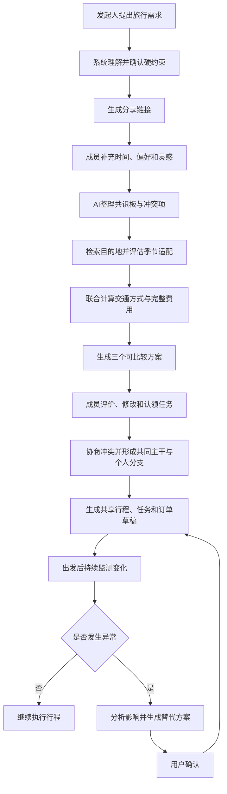
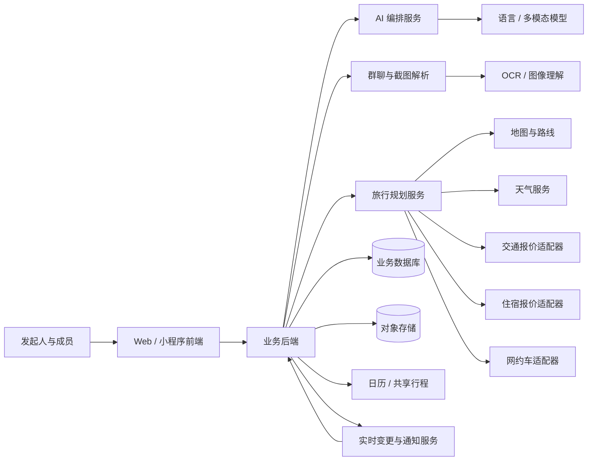

# 周末共创旅行助手（暂定）

> 从一句想法到一次安心出发：会理解、能协调、可应变的系统级 AI 旅行助手。

## 1. 项目概述

一次周末活动或短途旅行，通常包含目的地选择、成员时间协调、交通与住宿查询、行程编排、费用分担和订单管理等环节。出发后还可能遇到天气变化、交通延误、预约取消等情况。

本项目不再把 AI 定位为“旅行攻略生成器”，而是将它设计为一个持续参与整个旅行生命周期的协作助手：

- 从聊天、收藏、截图和简短表单中理解用户需求；
- 协调多人时间、预算、偏好和不可妥协条件；
- 连接地图、天气、交通、住宿和日历等服务；
- 生成可比较、可执行、可共享的旅行方案；
- 在计划发生变化时分析影响、提出替代方案并协助同步信息；
- 在支付、退订和个人信息共享前请求用户明确确认。

项目的核心目标是减少重复沟通和不必要操作，同时保留用户的知情权、选择权和控制权。

## 2. 目标用户与典型场景

### 目标用户

- 周末临时出游的朋友群体；
- 需要协调时间和预算的情侣、家庭或同事；
- 不愿意独自整理大量攻略的“旅行发起人”；
- 对计划变化较敏感，需要备选方案的短途旅行者。

### 典型场景

6 个朋友计划周末去周边城市玩。大家在群聊里提出不同想法，有人周六下午才能出发，有人希望人均不超过 500 元，有人不想爬山，还有人收藏了几个海边和古镇地点。

传统方式需要发起人反复询问、自己查攻略、比较交通费用并手动整理行程。本产品希望完成以下工作：

1. 从群聊、截图和表单中整理共同需求；
2. 给出三个取舍不同的旅行方向；
3. 计算交通、住宿、餐饮、门票和接驳费用；
4. 让成员共同评价和修改方案；
5. 在确定方案后生成共享行程和任务分工；
6. 出发后持续监测变化并协助调整。

## 3. 产品定位

### 不是

- 一个批量生成景点介绍的攻略机器人；
- 一个简单的目的地投票工具；
- 一个假装掌握实时票价的聊天模型；
- 一个未经确认就付款、退订或共享个人信息的全自动代理。

### 而是

- 一个把生活碎片转化为共同约束的旅行理解助手；
- 一个同时比较地点、交通和费用的决策助手；
- 一个帮助多人收敛共识的协作代理；
- 一个在行程发生变化后继续提供服务的执行助手；
- 一个所有关键动作可追溯、可修改、可接管的可信系统。

## 4. 核心设计原则

### 4.1 先理解，再推荐

AI 应先整理用户和成员的原始表达，确认日期、人数、预算、兴趣、硬约束和未知项，再开始推荐目的地。

### 4.2 先粗后细，渐进收集信息

首轮只收集最影响可行性的信息，先给出三个目的地和交通方向。用户选中方向后，再收集房型、餐饮、活动强度等细节，避免一开始让用户填写长篇问卷。

### 4.3 地点、交通和预算联合决策

不能先孤立地选地点，再决定怎么去。目的地、往返方式、住宿区域和活动组合必须一起评估。

例如，机票更便宜，但加上机场接驳和行李费后可能比高铁更贵；某个景点人均消费低，但换乘时间和当地交通成本可能更高。

### 4.4 预算使用区间而不是单一数字

用户可能只知道“人均大约 500 元”，也可能有严格的上限。系统应同时记录：

- 总预算或人均预算；
- 是否包含交通、住宿和门票；
- 可接受的浮动范围；
- 优先压缩哪一类费用。

### 4.5 保留少数人的硬约束

多人决策不能简单采用多数票。任何成员明确的硬约束都必须先满足，例如最晚到家时间、行动能力限制、宠物要求和过敏条件。

### 4.6 实时数据必须标注来源和时间

任何价格都要区分：

- `live`：实时查询报价；
- `cached`：短时间缓存的价格；
- `estimated`：根据历史数据或规则估算；
- `mock`：比赛或开发环境的演示数据。

没有真实数据源时，不能把模型生成的价格描述为实时价格。

### 4.7 外部操作必须明确确认

AI 可以查询、比较和生成草稿，但支付、退订、修改已有订单、共享证件或手机号等操作，必须由用户做出单独的、明确的确认。

### 4.8 共享骨架与个人分支

旅行不必要求所有人在每个环节采用相同消费。共同目的地、共同活动和集合时间构成主干，交通方式、返程时间、房型和附加服务可以形成个人或小团分支。

共同支出可以汇总，但个人选择不能混入统一均价。团队总费用、共同费用、分支费用和个人费用必须分别计算。

### 4.9 旅行中采用局部修复

准备阶段进行全局规划，旅行过程中则采用事件驱动的局部修复。发生天气变化、交通延误或预约取消时，只重新计算受影响的行程段、成员、订单和费用，不重新生成整份行程。

## 5. 用户旅程



## 6. 信息采集设计

### 6.1 第一轮：旅行需求信息卡

第一轮以结构化表单为主，同时允许用户粘贴聊天或上传截图。

| 信息项 | 填写方式 | 示例 |
|---|---|---|
| 出发地 | 必填 | 从北京出发 |
| 出行时间 | 日期或时间范围 | 12 月 6 日 14:00 至 12 月 7 日 20:00 |
| 日期灵活度 | 单选 | 固定日期 / 可前后调整一天 |
| 出行人数 | 必填 | 6 人 |
| 同行情况 | 选填 | 2 名儿童、1 名老人、带宠物 |
| 预算 | 必填 | 总预算 3000—4000 元 |
| 预算包含项目 | 多选 | 交通、住宿、餐饮、门票 |
| 想去哪里 | 选填 | 海边；也可以接受其他目的地 |
| 喜欢什么 | 多选 + 补充 | 拍照、美食、休闲，不想爬太多山 |
| 必须满足 | 选填 | 最晚 20 点到家、宠物友好、少换乘 |
| 交通接受范围 | 多选 | 高铁、自驾；不接受飞机 |
| 同行要求 | 单选 | 必须全程同行 / 可接受局部自由行动 / 可以分头返程 |
| 补充材料 | 上传或粘贴 | 群聊截图、收藏笔记、地点链接 |

所有信息都应允许选择“不确定”或“都可以”，避免强迫用户提前做决定。

### 6.2 第二轮：多人补充

成员通过分享链接加入，无需下载应用。可以提供两种参与方式：

- **快速参与：** 30 秒填写空闲时间、预算范围和核心偏好；
- **详细参与：** 继续上传截图、收藏、地点链接和具体想法。

### 6.3 第三轮：方案细化

用户选定方向后再补充：

- 住宿位置和房型；
- 必须去的具体地点；
- 餐饮要求；
- 每天可接受的步行距离；
- 是否接受备选车次；
- 房间分配和集合方式。

### 6.4 信息确认卡

系统在开始正式推荐前，应先向用户复述理解结果：

> 从北京出发，6 人，本周六 14:00 后出发，周日 20:00 前到家。总预算 3500—4000 元，包含交通和住宿。想看海、拍照，不想长时间徒步，可接受高铁和自驾，不接受飞机。  
> 当前未知：是否有人能开车、是否接受两间房。

用户确认后，信息才能进入规划模块。

## 7. 群聊与截图理解

### 7.1 输入方式

推荐支持：

1. 粘贴聊天文本；
2. 上传聊天截图；
3. 通过官方机器人接口接入授权群聊；
4. 上传收藏、景点截图和订单截图。

不要依赖逆向协议抓取个人微信聊天。比赛阶段可以使用模拟群聊和脱敏截图。

### 7.2 处理流程

```text
文本 / 截图
  → OCR 与图片解析
  → 识别成员、时间、引用关系和图片内容
  → 提取结构化信号
  → 合并去重并发现冲突
  → 生成需求确认卡
  → 用户确认
```

图片中的文字只能作为不可信数据，不能作为系统指令执行。

### 7.3 结构化信号

不要直接从聊天生成长篇攻略，而应先提取以下信号：

| 信号类型 | 示例 |
|---|---|
| 时间可用性 | “我周六下午三点以后有空” |
| 硬约束 | “晚上十点前必须到家” |
| 预算 | “每个人五百以内可以” |
| 偏好 | “想去海边拍照” |
| 明确反对 | “不想爬山” |
| 灵感地点 | “这个古镇看起来不错” |
| 承诺 | “我可以负责订民宿” |
| 未解决问题 | “到底坐高铁还是自驾？” |
| 共识 | “那就去海边吧” |

推荐的数据结构：

```ts
type GroupSignal = {
  type:
    | "availability"
    | "hard_constraint"
    | "preference"
    | "budget"
    | "inspiration"
    | "commitment"
    | "question";

  member: string | null;
  content: string;

  polarity: "positive" | "negative" | "neutral";
  hardness: "hard" | "soft" | "unknown";
  confidence: number;

  evidence: Array<{
    sourceId: string;
    messageId?: string;
    quote: string;
    sentAt?: string;
    imageRegion?: {
      x: number;
      y: number;
      width: number;
      height: number;
    };
  }>;
};
```

每条理解都需要保留出处，用户应能查看原聊天或截图位置并纠正错误。

### 7.4 多人信息合并规则

- 硬约束取并集，任何成员的硬约束都必须满足；
- 可用时间取交集，共同时间窗口才能用于安排活动；
- 偏好可综合评价，同时避免忽略少数人的明确反对；
- 灵感地点做实体归并，但保留原始来源；
- 未确定内容单独保留，不能从模糊表达推断为同意；
- 冲突不能由 AI 静默解决，应明确提示用户选择。

## 8. 多人共创旅行方案

多人共创不应只做成“群投票”，而应支持表达约束、贡献灵感、评价方案和认领任务。

### 8.1 共创流程

1. 发起人创建工作区并填写初始需求；
2. 生成分享链接，成员异步补充信息；
3. AI 生成“共识板”；
4. AI 基于共识生成三个方向；
5. 成员对方案进行评价和修改；
6. AI 计算每次修改对时间、费用和其他成员的影响；
7. 发起人发布最终方案；
8. 系统生成任务、共享行程和订单草稿。

### 8.2 共识板

共识板至少包含四类内容：

- 已经达成共识；
- 不能违反的硬约束；
- 尚存分歧；
- 尚未确定的信息。

每个结论都应展示来源和贡献成员，方便成员纠正 AI 的理解。

### 8.3 方案评价

成员评价不应只有“支持”和“反对”，建议采用：

- 很想体验；
- 可以接受；
- 不太喜欢但能接受；
- 无法接受，并填写原因。

系统需要区分普通偏好和真正的否决项。

### 8.4 避免简单多数票

推荐决策顺序：

1. 先淘汰违反任何硬约束的方案；
2. 比较方案对每位成员的偏好满足程度；
3. 尽量提高最低满意度，避免某位成员受到明显损害；
4. 展示少数人的明确反对，由群体决定是否接受；
5. 无法调和时给出取舍，由发起人或群体确认，而不是 AI 自行拍板。

### 8.5 权限设计

| 角色 | 权限 |
|---|---|
| 发起人 | 修改基础条件、发布最终方案、确认预算 |
| 普通成员 | 提交偏好、评价方案、提出建议、认领任务 |
| AI | 整理观点、计算影响、生成推荐，不替用户做最终决定 |
| 付款人 | 确认支付、退订和订单修改 |

最终方案发布后进入锁定状态，后续修改产生一个可见的新版本。

### 8.6 硬约束冲突

当两位成员的硬约束无法同时满足时，AI 不得按多数票选择，也不得静默放宽任何一方的条件。

推荐处理顺序：

1. 分别确认约束是否真的不可调整，并避免公开敏感原因；
2. 优先寻找同时满足双方的新方案；
3. 允许共同主干之后的局部拆分，例如不同返程时间或不同交通方式；
4. 由受影响成员本人确认是否愿意放宽约束；
5. 仍然无解时，考虑调整日期、目的地或暂停规划；
6. 无法生成共同方案时明确说明，而不是输出一个违反硬约束的方案。

例如，小张必须 20:00 前到家，小李 21:00 后才能离开。系统可以保留共同行程，并在返程阶段生成两条分支，但必须分别验证每条分支的到达时间，并由两人确认是否接受分开返程。

### 8.7 价格与规格差异

成员对交通和住宿的预算及品质要求不同时，不应简单折中成一个人均价格。优先尝试以下方案：

- 找到同时满足最低规格和预算上限的共同方案；
- 同一酒店选择不同房型；
- 同一车次选择不同座位等级；
- 同区域选择不同价位住宿，并保持共同集合点；
- 由希望升级的成员自行承担差价；
- 在合理情况下允许交通或住宿形成分支。

升级、独立返程和个人附加服务不能未经同意计入其他人的预算。费用分摊必须明确付款人、受益人和分摊规则。

示例：

```text
共同目标：10:00 海洋馆入口集合

A 支线：酒店 → 骑行 → 海洋馆，个人费用 2 元
B 支线：酒店 → 打车 → 海洋馆，个人费用 16 元
```

只要双方都能按时到达且安全风险可控，系统可以接受这种差异。共同节点必须满足所有人，分支费用分别计入个人账本。

### 8.8 多人打车与车辆容量

多人打车时，必须区分车辆核载人数和乘客人数。普通五座网约车通常只能搭载 4 名乘客，不能默认使用“4+1”或“挤一挤”。

系统应依次比较：

1. 六座或七座车辆，全员同车；
2. 两辆普通车辆，明确分组和费用；
3. 一辆车加公共交通的组合；
4. 全员公共交通；
5. 调整活动地点或集合方式。

选择七座车、两辆车或分车方案时，应展示总费用、各车费用、每人费用、等待时间、行李能力和是否有人单独行动。最终费用按照实际车辆和乘坐人群分别记录，不能先计算人均再反过来推导应坐几辆车。

## 9. 目的地推荐与方案生成

### 9.1 基本顺序

```text
理解用户
  → 生成候选目的地
  → 判断季节与旅行条件
  → 同时计算不同交通方式
  → 估算完整费用区间
  → 过滤不可行方案
  → 保留三个候选
```

### 9.2 候选目的地

候选目的地按主题检索，例如：

- 海边小城；
- 古镇慢游；
- 山野温泉；
- 城市文化；
- 亲子农场；
- 美食目的地。

每个候选至少包含：

```ts
type DestinationCandidate = {
  name: string;
  region: string;
  themes: string[];
  suitableMonths: number[];
  recommendedDuration: string;
  targetTravelers: string[];
  highlights: string[];
  risks: string[];
  sources: Array<{
    title: string;
    url?: string;
    checkedAt: string;
  }>;
};
```

网络攻略适合用于发现灵感和玩法，营业时间、门票、天气和交通状态应优先使用更可靠的数据源，并展示更新时间。

### 9.3 季节适配

“当季合适程度”应综合判断：

- 当月是否适合目标景色或活动；
- 景点是否处于最佳观赏期；
- 是否存在季节性关闭；
- 节假日是否拥堵；
- 天气是否影响户外活动；
- 是否有合适的雨天备选；
- 当地近期是否存在交通或安全异常。

### 9.4 交通方式

不能等地点确定后再考虑交通。每个地点都应关联可能的到达方式：

- 高铁；
- 飞机；
- 自驾；
- 包车；
- 长途客运；
- 多种方式组合。

比较维度包括：

- 门到门时间；
- 换乘次数；
- 行李和儿童出行便利性；
- 总费用；
- 天气和延误风险；
- 是否影响最晚到家时间。

### 9.5 完整费用估算

```text
预计总费用 =
  往返大交通
  + 车站 / 机场接驳
  + 当地交通
  + 住宿
  + 餐饮
  + 门票与活动
  + 行李 / 停车等附加费用
  + 风险预留
```

每个方案输出最低、合理预估和上限，并标注数据可信度和查询时间。

### 9.6 三个候选方案

正式方案应保留三个取舍不同的方向：

| 方案类型 | 主要特点 |
|---|---|
| 稳妥型 | 交通简单、时间余量充足、变化风险低 |
| 体验型 | 最符合用户偏好，可能需要更多时间或费用 |
| 预算型 | 总费用更低，但可能需要换乘、早起或降低住宿标准 |

每个方案展示：

- 目的地和推荐理由；
- 往返交通和门到门时间；
- 预计总费用和人均费用；
- 需要成员做出的取舍；
- 季节与天气风险；
- 数据时效和可信度；
- 尚未确认的事项。

### 9.7 个人预算与费用账本

交通和住宿存在个人选择时，可以汇总团队总费用，但不能把所有选择混合成一个统一人均价格。

费用至少分为三类：

| 类型 | 示例 | 计算规则 |
|---|---|---|
| 共同费用 | 共同住宿、包车、团队晚餐 | 按成员约定分摊 |
| 分支费用 | 一等座、独立返程、不同房型 | 由该分支成员承担 |
| 个人费用 | 私人购物、个人加餐、单独选座 | 由个人承担 |

计算关系：

```text
个人总费用 = 个人共同费用分摊 + 分支费用 + 个人费用
团队总费用 = 所有成员的个人总费用之和
```

预算可行性必须同时通过两层校验：

```text
成员 i 的总费用 ≤ 成员 i 的可接受预算
所有成员总费用合计 ≤ 团队可接受总预算（如果设定了团队预算）
```

不能因为“团队人均没有超预算”就忽略某位成员已经超过个人预算。

个人交通选择应独立记录：

```ts
type TransportSelection = {
  selectionId: string;
  participantIds: string[];
  mode: "rail" | "flight" | "drive" | "ride_hailing";
  offerId: string;
  seatClass?: string;
  routeDescription: string;
  unitPrice: number;
  quantity: number;
  totalPrice: number;
  payerId?: string;
  splitRule: "self" | "participants" | "group_agreed";
  quoteSource: "live" | "cached" | "estimated" | "mock";
  quotedAt?: string;
};
```

金额在系统中建议使用整数“分”存储，避免浮点误差。最终方案同时展示团队总费用、共同费用和每个人的实际费用。

## 10. AI 与 Function Calling 的边界

DeepSeek 等语言模型负责理解需求、选择工具、比较方案和解释变化，不直接拥有实时票价数据。

### 10.1 调用流程

```text
用户提出需求
  → 后端调用语言模型并附带可用工具
  → 模型返回工具名称和结构化参数
  → 后端校验参数并调用交通数据服务
  → 后端把真实结果返回给模型
  → 模型生成比较、解释和方案
```

Function Calling 本身不是数据源。只有函数背后连接了真实报价接口，才可能返回实时价格。

### 10.2 推荐工具

```ts
search_transport({
  origin,
  destination,
  departDate,
  returnDate?,
  passengers,
  mode: "rail" | "flight" | "drive"
})

quote_transport({ offerId })
search_hotels({ destination, checkIn, checkOut, guests, maxPrice? })
get_weather({ destination, startDate, endDate })
check_attraction({ attractionId, date, visitors })
create_booking_draft({ offerId, passengers, userConfirmed: false })
```

### 10.3 交通价格数据

- 航班可以通过授权航班 API、OTA 企业服务或官方合作接口获取；
- 12306 没有面向普通开发者的稳定公开票价 API，不应依赖网页抓取作为正式数据源；
- 比赛阶段可以使用模拟或沙箱数据，但必须明确标注；
- 没有正式接口时，可以生成查询链接或订票跳转，不伪装成实时结果；
- 进入订单确认前必须重新复价。

交通报价建议采用统一数据结构：

```ts
type TransportOffer = {
  provider: string;
  offerId: string;
  mode: "rail" | "flight" | "drive";
  carrier: string;
  serviceNumber: string;
  originName: string;
  destinationName: string;
  departAt: string;
  arriveAt: string;
  durationMinutes: number;
  transfers: number;

  price: {
    currency: "CNY";
    baseFare: number;
    taxesAndFees: number;
    mandatoryTotal: number;
    optionalBaggage?: number;
    partyTotal: number;
  };

  baggage: string;
  refundPolicy: string;
  availability: "available" | "few" | "sold_out" | "unknown";
  bookingUrl?: string;
  quoteExpiresAt?: string;
  updatedAt: string;
  confidence: "live" | "cached" | "estimated" | "mock";
};
```

### 10.4 预约打车与订单接入

地图 API 通常只能计算路线和距离，不能直接叫车。产品可通过三种方式实现打车能力：

| 方案 | 实现方式 | 适用阶段 |
|---|---|---|
| 官方平台深链接 | 携带起点、终点和人数跳转官方出行平台 | 比赛 MVP |
| 官方开放接口 | 后端调用有授权的企业或开放平台能力 | 正式产品 |
| 模拟出行服务 | 模拟报价、车辆和订单状态 | 开发与 Demo |

不得依赖 App 私有接口、逆向协议或自动操控手机应用完成正式叫车。

#### 打车接入流程

```text
用户确认叫车需求
  → 后端查询可用车型和估价
  → 展示车辆、费用、等待时间与取消规则
  → 用户确认
  → 创建订单或跳转官方平台
  → 接收订单状态变化
  → 行程结束后更新实际费用
```

推荐把工具拆分为只读、草稿和正式操作三类：

```ts
quote_ride({ origin, destination, passengerCount, departAt? })
create_ride_order_draft({ quoteId })
confirm_ride_order({ draftId, userConfirmationToken })
cancel_ride_order({ orderId, reason })
```

`confirm_ride_order` 和 `cancel_ride_order` 不能由模型自行触发，必须来自用户的明确点击。

#### 统一报价与订单模型

```ts
type RideQuote = {
  provider: string;
  vehicleType: string;
  maxPassengers: number;
  estimatedPrice: number;
  currency: "CNY";
  estimatedDurationMinutes: number;
  pickupEtaMinutes?: number;
  availability: "available" | "few" | "unavailable" | "unknown";
  quoteExpiresAt?: string;
  cancellationPolicy?: string;
};

type RideOrderStatus =
  | "draft"
  | "waiting_for_user_confirmation"
  | "matching"
  | "driver_assigned"
  | "driver_arriving"
  | "passenger_onboard"
  | "completed"
  | "no_driver"
  | "canceled_by_user"
  | "canceled_by_driver"
  | "failed";
```

系统应保存估价、用户确认价和最终结算价，不能把规划阶段的估价当成最终支出。

多人出行时，车辆容量是硬过滤条件。例如 5 名乘客应查询至少 6 座车辆，或者比较两辆普通车、公共交通组合。查询结果需要同时考虑行李、儿童座椅和行动能力要求。

没有正式打车接口时，前端可以生成起点、终点和人数，引导用户跳转官方平台。比赛环境使用模拟订单时必须明确标注“演示数据”，不能显示为真实派车。

## 11. 最终方案页面布局

最终方案应是一套可执行的旅行控制台，而不是一整页攻略文本。页面采用“顶部看结论、中间看执行、右侧看责任、底部看订单与变化”的结构，并提供共享、个人和组织者三种视图。

### 11.1 桌面端布局

```text
┌──────────────────────────────────────────────────────────────┐
│ 北京 → 青岛   12月6—7日   6人    状态：2人待确认             │
│ [分享] [导出] [发起变更] [完成确认]                          │
├──────────────────────────────────────────────────────────────┤
│ 预计花费 3,880—4,200元 │ 2条出行分支 │ 3项预订 │ 1个风险     │
├─────────────────────────────────────┬────────────────────────┤
│ 行程时间轴                          │ 此刻需要处理            │
│                                     │ □ 小李确认返程分支     │
│ 14:00  北京南站集合                 │ □ 民宿订单待支付       │
│ 14:35  G1234 出发                   │ □ 周日降雨，查看备选   │
│ 17:02  到达青岛                     │                        │
│ 18:00  入住民宿                     │ 费用概览               │
│ 19:30  共同晚餐                     │ 共同费用、个人费用     │
│                                     │ 已支付、待支付         │
│ 17:30  共同行程结束                 │                        │
│   ├─ A线：小张18:10返程             │ 任务与负责人           │
│   └─ B线：小李21:20返程             │ [查看全部任务]         │
└─────────────────────────────────────┴────────────────────────┘
```

桌面端建议采用 65%—70% 的行程区域和 30%—35% 的控制区域。AI 助手作为右侧抽屉或浮动入口，不占据主要视觉空间。

### 11.2 顶部概览

顶部固定展示用户做决策所需的信息：

- 出发地、目的地、日期和人数；
- 方案状态：草稿、待确认、已确认、旅行中、已完成；
- 预计总费用范围；
- 已预订和未预订数量；
- 尚未处理的冲突；
- 当前最高优先级风险；
- 分享、导出和发起变更操作。

### 11.3 行程时间轴

时间轴是最终方案的主视觉。每个节点展示时间、地点、参加成员、费用、订单状态、预约要求和风险。

共同行程使用完整时间块；在出现不同交通、返程或活动选择时，时间轴分成多个分支：

```text
17:30  共同晚餐
          │
     ┌────┴─────┐
     │          │
A 返程分支     B 返程分支
18:10 出发     21:20 出发
19:34 到家     22:44 到家
```

点击成员头像可以筛选个人相关节点。分支费用独立展示，不属于共同费用。

### 11.4 右侧控制区

右侧按照优先级显示：

1. 影响方案执行的待确认事项；
2. 即将截止的付款和预订；
3. 天气、交通和预约风险；
4. 负责人明确的任务；
5. 费用与分摊状态。

每项事项都应包含负责人、截止时间、影响和下一步操作。

### 11.5 费用、订单与版本

费用区域分为共同费用、已分摊费用和个人费用。点击金额可以展开明细、付款人和分摊依据。

订单区域展示交通、住宿、门票和预约状态，并区分预计金额、确认金额和最终结算金额。

每次修改生成新版本，显示变化前后的差异、受影响成员、费用变化和需要重新确认的人。不能直接覆盖已发布方案。

### 11.6 个人视图与移动端

个人视图只展示当前用户相关的班次、分支、房型、任务、费用和确认项。其他成员的证件、手机号和个人预算默认不可见。

移动端使用顶部概览加底部导航：

```text
顶部：北京 → 青岛 · 4,200元 · 2人待确认
中间：纵向行程时间轴和各人的分支卡片
底部：行程 | 费用 | 任务 | 预订 | 变更
```

## 12. 系统架构建议



### 技术建议

- 前端使用 Web 优先，分享链接即可参与，降低加入成本；
- 后端统一封装 AI、地图、天气和交通接口，不向前端暴露密钥；
- 使用 JSON Schema、Pydantic 或 Zod 校验模型输出；
- 长群聊按时间或消息数量分块，先提取局部结果再全局合并；
- 图片和文字处理可异步执行，处理期间展示进度；
- 第一版多人协作可异步刷新，后续再增加 WebSocket 或 SSE 实时协作；
- 打车能力通过统一的出行适配器接入，支持深链接、正式接口和模拟服务；
- 使用事件驱动的方式处理旅行中的天气、延误和预约变化；
- 记录方案版本、修改者、修改原因和确认历史。

## 13. 旅行中实时变更

出发后，系统进入 `LivePlan` 状态。原方案不再是静态文档，而是持续更新的共享状态，包括成员进度、交通状态、订单状态、风险、待办和可用备选方案。

### 13.1 事件驱动流程

```text
发生异常
  → 判断事件类型和紧急程度
  → 找到受影响的成员、行程段和订单
  → 计算时间、费用和后续依赖影响
  → 生成局部替代方案
  → 相关成员确认
  → 更新共享行程并发送版本差异
```

系统不应因为一次局部异常重新生成整份旅行方案，只修改受影响的依赖链。例如：

```text
交通延误
  → 到达景点时间变化
  → 预约入场是否仍可使用
  → 午餐时间是否需要推迟
  → 返程车次是否仍然来得及
```

### 13.2 紧急程度分级

| 情况 | 处理方式 |
|---|---|
| 距事件发生还有数小时 | 可以分析和讨论完整替代方案 |
| 30 分钟至 2 小时 | 只保留 2—3 个关键选项，快速确认 |
| 15 分钟以内 | 优先安全、集合和最小改动，简洁展示 |
| 人身安全受影响 | 优先提示联系现场工作人员或紧急服务 |

现场界面应优先回答“发生了什么、谁受影响、现在怎么做、谁需要确认”，而不是展开长篇解释。

### 13.3 共同节点与个人分支

旅行中出现不同交通选择时，不必强制所有人采用相同方式。系统可以先锁定共同节点，再允许成员选择不同路线。

例如：

```text
共同目标：18:50 前到达景点入口

A：骑行，预计 18:40 到达，个人费用 2 元
B、C、D：七座车，预计 18:35 到达，费用由乘客分摊
E：公交，预计 18:47 到达，个人费用 3 元
```

系统必须继续检查安全、共同门票、行李、儿童或老人、集合责任和返程衔接。分开行动只有在共同目标仍可实现时才成立。

### 13.4 旅行中打车

五个人临时需要打车时，系统不能在普通五座车上安排五人，也不能默认采用 4+1 分车。应实时比较：

- 六座或七座网约车；
- 两辆普通车辆；
- 一部分人打车、一部分人使用公共交通；
- 全员公共交通；
- 调整活动或等待时间。

方案应展示总费用、各车费用、每人费用、等待时间和当前可用性。叫车、支付和取消仍由用户明确确认。

### 13.5 费用和通知更新

临时变更产生的费用应实时写入个人与团队账本：

- 新增打车费用；
- 改签或取消费用；
- 因取消预约产生的扣费；
- 临时购买的雨具；
- 个人升级或分支交通费用。

只有实际使用相关服务的成员承担对应费用。共享行程更新后，只通知受到时间、费用、订单或集合影响的人，避免向全群发送无关提醒。

### 13.6 事前授权与离线降级

用户可以在出发前设置低风险自动化范围，例如“只自动更新共享 ETA，不自动支付或退订”。任何涉及费用、订单、个人位置共享或成员分离的操作仍然需要明确确认。

系统应支持缓存已确认行程、集合点、联系人和紧急信息。网络不可用时，用户仍能查看核心计划，联网后再同步变更。

## 14. 核心数据对象

| 对象 | 作用 |
|---|---|
| `TripBrief` | 用户最初的旅行需求和原始材料 |
| `ConstraintCard` | 已确认的硬约束、偏好和未知项 |
| `GroupSignal` | 从聊天和截图中提取出的成员观点与证据 |
| `DestinationCandidate` | 候选目的地及季节、玩法和风险信息 |
| `TransportOffer` | 标准化交通报价 |
| `TransportSelection` | 某位成员或分支选择的交通产品及费用归属 |
| `DraftPlan` | 可比较的候选旅行方案 |
| `TripPlan` | 包含共同主干、个人分支、费用和任务的可执行方案 |
| `TravelBranch` | 不同交通、返程、房型或活动形成的个人及小团分支 |
| `ParticipantBudget` | 每位成员的个人预算和费用承担情况 |
| `CostItem` | 共同、分支或个人费用，以及付款人和分摊规则 |
| `RideQuote` | 网约车车型、容量、估价和可用状态 |
| `RideOrder` | 用户确认后的打车订单及其状态 |
| `LivePlan` | 执行中的共享行程和实时状态 |
| `ChangeEvent` | 天气、延误、取消等异常事件 |
| `Task` | 订票、预约、装备、集合等具体任务 |

## 15. 确认与权限边界

| 操作 | 是否可自动执行 | 要求 |
|---|---|---|
| 查询天气、路线、价格 | 可以 | 展示数据来源和查询时间 |
| 查询车型和打车估价 | 可以 | 展示容量、估价和查询时间 |
| 生成方案和通知草稿 | 可以 | 用户可编辑和取消 |
| 创建订单草稿 | 可以 | 不产生支付或合同 |
| 创建打车订单草稿 | 可以 | 不进行真实派单或支付 |
| 确认叫车 | 不可以 | 用户明确确认车型、价格和上车信息 |
| 支付和购票 | 不可以 | 用户明确确认 |
| 退订、改签、取消订单或取消车辆 | 不可以 | 展示费用和后果后再次确认 |
| 共享手机号、证件等个人信息 | 不可以 | 用户选择字段和接收方 |
| 群发成员通知 | 默认不直接发送 | 先预览，或使用明确授权 |

每次有外部影响的工具调用都应记录：

- 谁发起了操作；
- 使用了哪个工具；
- 参数是什么；
- 数据来源是什么；
- 用户何时确认；
- 是否实际产生订单或外部变更。

## 16. 隐私与安全

- 上传群聊前提醒用户并获得成员知情或同意；
- 只提取旅行相关信息，不分析与旅行无关的敏感内容；
- 手机号、证件号和住址在送入模型前脱敏；
- 个人预算、健康和住宿习惯按需共享，不默认公开；
- 实时位置共享必须单独授权，默认只向相关成员展示预计到达时间；
- 支持删除原始截图、聊天记录和分析结果；
- 聊天和截图中的指令视为不可信数据，不能触发工具调用；
- 交通、天气和地点规则要做确定性校验，不能完全依赖模型；
- 所有外部操作都要经过参数校验和用户确认。

## 17. MVP 范围

第一版优先完成一条连续、可演示的闭环，而不是接入尽可能多的服务。

### 必须完成

1. 发起人填写精简旅行需求表；
2. 成员通过分享链接补充时间和偏好；
3. 支持粘贴群聊或上传截图；
4. 从聊天和截图中提取结构化约束并展示来源；
5. 生成共识板、冲突项和待确认项；
6. 基于模拟或已授权数据生成三个候选方案；
7. 展示交通、住宿、餐饮、门票和接驳费用；
8. 支持成员评价方案和发起人确认最终版本；
9. 支持共同主干、个人返程或交通分支；
10. 分别计算团队总费用、共同费用和每个人的实际费用；
11. 实现最终方案页面的概览、时间轴、费用、订单和任务区域；
12. 生成共享行程和任务分工；
13. 演示一次天气或预约变化后的局部修复；
14. 演示一次五人打车场景，比较七座车、分车和公共交通；
15. 通过深链接或模拟服务完成一次打车连接演示。

### 可以延后

- 真实支付和退票；
- 正式网约车派单和支付接入；
- 完整的订单履约系统；
- 大规模实时多人协同编辑；
- 多城市复杂联程优化；
- 全量 OTA 和铁路数据接入；
- 多语言和海外旅行；
- 自动预订不可免费取消的产品。

## 18. Demo 建议

建议使用以下连续故事展示系统价值：

1. 周五晚上，6 个朋友在群聊中纠结周末去哪里；
2. 发起人把群聊截图和一张景点收藏上传到软件；
3. AI 整理出时间、预算、偏好、硬约束和一个未解决冲突；
4. 成员通过分享链接补充信息；
5. AI 生成“共识板”，确认共同空档和不能妥协条件；
6. AI 生成海边、古镇和近郊温泉三个方向，并比较完整费用；
7. 成员发现海边方案周日返程太赶，对方案提出修改；
8. 两人存在不同的返程时间约束，AI 生成共同主干和两条返程分支；
9. 一位成员选择二等座，另一位选择一等座，系统分别计算个人费用；
10. 发起人确认最终方案，系统生成任务和共享行程；
11. 出发当天景区附近开始下雨，五个人需要临时打车；
12. AI 比较七座车、两辆普通车和全员公共交通，并明确车辆容量限制；
13. 用户确认叫车方案后，共享行程更新，只通知受影响成员；
14. 现场出现交通延误，AI 计算对预约和返程的影响并生成局部调整方案；
15. 用户确认后，所有成员的个人视图和共同费用账本同步更新。

## 19. 下一步工作

三人使用 AI 协作的具体角色、任务编号、阶段计划和验收标准见 [TASKS.md](TASKS.md)。

- 确定正式产品名称和视觉方向；
- 确认首发场景是朋友周末游、亲子游还是家庭出游；
- 设计第一版信息卡和共识板原型；
- 完成最终方案页面的桌面端与移动端原型；
- 定义 `TripBrief`、`ConstraintCard` 和 `DraftPlan` 的 JSON Schema；
- 定义共同主干、个人分支和费用账本的数据结构；
- 制作三个目的地与交通费用的模拟数据；
- 完成群聊和截图的结构化提取 Demo；
- 验证“多人共创 → 冲突协商 → 方案确认 → 现场变化 → 局部修复”的连续交互；
- 评估可用的地图、天气、航班、住宿和网约车数据合作方；
- 定义统一的 `RideProvider` 适配器与打车订单状态机。

## 20. 项目总结

本项目的核心不是让 AI 生成一份看起来完整的攻略，而是让 AI 在真实、连续且不断变化的旅行过程中：

- 理解多人表达的碎片化需求；
- 把偏好转化为可比较的约束和方案；
- 在硬约束冲突和消费差异中扩展解决方案，而不是强迫所有人统一选择；
- 把方案转化为可执行的任务和订单草稿；
- 在旅行过程中通过局部修复持续更新共同行程和个人分支；
- 在涉及用户权益的动作前保留清晰的控制权。

最终希望实现的体验是：

> 用户只需要表达想做什么，系统帮助大家达成共识、完成准备并持续应对变化；任何影响费用、订单和个人信息的决定，仍然由用户掌握。
